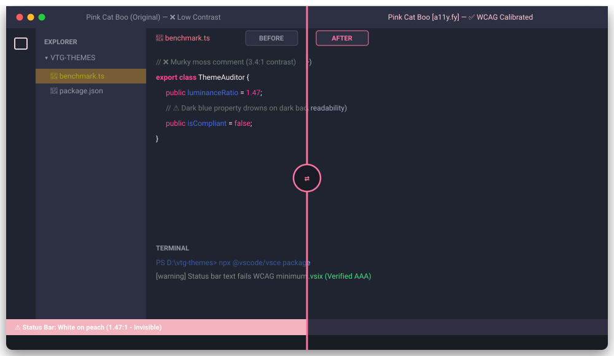

# a11y.fy Themes [Work in Progress]

> 🚧 **Work in Progress**: This theme collection is actively being remediated and benchmarked against real-world eye strain. We are taking community-favorite themes and methodically repairing contrast traps one theme at a time.
>
> **Curated & Tuned by [Voltaire Toledo](https://proventuras.com)**  
> **Published by [ProVenturas](https://proventuras.com)**

[](https://github.com/voltaire-toledo/a11y.fy-themes)
[](#why-a11yfy-exists)
[](#remediation-roadmap)

---

## Why a11y.fy Exists

I love great aesthetic themes—especially soft pastels and vibrant syntax hues like *Pink Cat Boo*, *Catppuccin*, and *Tokyo Night*. 

However, as someone living with a vision impairment, spending 8+ hours a day in these themes revealed how many hidden traps exist in standard community palettes:

* **The "Invisible Text" Trap**: Pastel status bars where white text on light peach produces a **1.47:1** ratio—practically invisible unless you lean right against the screen.
* **The "Glaring Flashlight" Bar**: When an entire monitor width is filled with high-luminance peach along the bottom, it causes painful glare in low-light rooms.
* **Ghost Comments**: Murky olive or dark moss green comments that blend straight into the background canvas.
* **Dark Blue Drowning**: Deep navy property names and terminal path colors that drop below a readable contrast against dark themes.
* **The Out-of-Focus Olive Trap**: When you select a modified file in the file explorer and switch back to code, the unselected filename turns into an unreadable olive smudge (`#a8a70f` on `#765d36`).

### The Goal: High Contrast Without the "High Contrast" Harshness
Built-in OS high-contrast themes often resort to neon-green outlines on stark `#000000` pitch-black boxes. That creates visual jarring.

`[a11y.fy]` takes a human approach: **keep the artistic identity, mood, and beauty of the theme, but fix the contrast mathematics so your eyes don't hurt.**

---

## 🌸 Theme 1: Pink Cat Boo [a11y.fy]

Here is the direct before-and-after visual breakdown showing what changed and why:



### What Changed in Pink Cat Boo:

| Element | The "Before" Problem | The "After" a11y.fy Solution | Contrast Impact |
| :--- | :--- | :--- | :--- |
| **Status Bar** | Full bright peach bar with white text causing glare & unreadable text | Window-matched `#302f42` bar with soft rose text (`#fed7e2`) and WSL accent pill | **9.4 : 1 (WCAG AAA)** — Zero glare |
| **Comments** | Murky olive moss (`#6D7A72`) | Crisp Silver-Lavender (`#a2a8c2`) | **6.2 : 1 (WCAG AA+)** |
| **Properties** | Dark cobalt blue (`#4169e1` / `#6089B4`) drowning on dark canvas | Luminous Light Sky Blue (`#93d5f8`) via semantic tokens | **9.8 : 1 (WCAG AAA)** |
| **Inactive Filenames** | Unfocused modified files turned olive on mud brown (`#a8a70f` on `#765d36`) | High-contrast berry-slate background (`#382436`) with canary yellow git text (`#fde047`) | **8.6 : 1 (WCAG AAA)** |
| **Terminal Blues** | Dark cobalt terminal paths and Git output | Accessible Sky Blue (`#70b8ff`) | **8.2 : 1 (WCAG AAA)** |
| **Tab Dividers** | Lost separation between tabs | Restored subtle vertical dividers (`#33384c88`) | Instant tab boundary recognition |

> 🎮 **Want to slide between the two live?**  
> Check out the interactive split-slider in [`docs/index.html`](https://voltaire-toledo.github.io/a11y.fy-themes/ or locally).

---

## 🗺️ Remediation Roadmap

We imported the top community dark themes into this workspace. Each one is currently queued for hands-on remediation:

- [x] **Pink Cat Boo [a11y.fy]** — ✅ *Remediation Complete*
- [ ] **Catppuccin Mocha [a11y.fy]** — ⏳ *In Progress*
- [ ] **Catppuccin Macchiato [a11y.fy]** — ⏳ *Queued*
- [ ] **Catppuccin Frappé [a11y.fy]** — ⏳ *Queued*
- [ ] **Tokyo Night [a11y.fy]** — ⏳ *Queued*
- [ ] **Tokyo Night Storm [a11y.fy]** — ⏳ *Queued*
- [ ] **Dracula [a11y.fy]** — ⏳ *Queued*
- [ ] **Dracula Soft [a11y.fy]** — ⏳ *Queued*
- [ ] **One Dark Pro [a11y.fy]** — ⏳ *Queued*
- [ ] **One Dark Pro Darker [a11y.fy]** — ⏳ *Queued*
- [ ] **Gruvbox Material Dark [a11y.fy]** — ⏳ *Queued*
- [ ] **SynthWave '84 [a11y.fy]** — ⏳ *Queued*

---

## How to Test Locally on Your Machine

You can package and install the current release directly into VS Code or VS Code Insiders:

```bash
# 1. Clone this repository
git clone https://github.com/voltaire-toledo/a11y.fy-themes.git
cd a11y.fy-themes

# 2. Package into a local .vsix
npx @vscode/vsce package

# 3. Install in VS Code
code --install-extension vtg-pub-vscode-themes-0.1.0.vsix
# (or 'code-insiders' if using Insiders)
```

---

## Author & Engineering

* **Curator & Lead**: [Voltaire Toledo](https://proventuras.com)
* **Publisher**: [ProVenturas](https://proventuras.com)
* **License**: MIT
